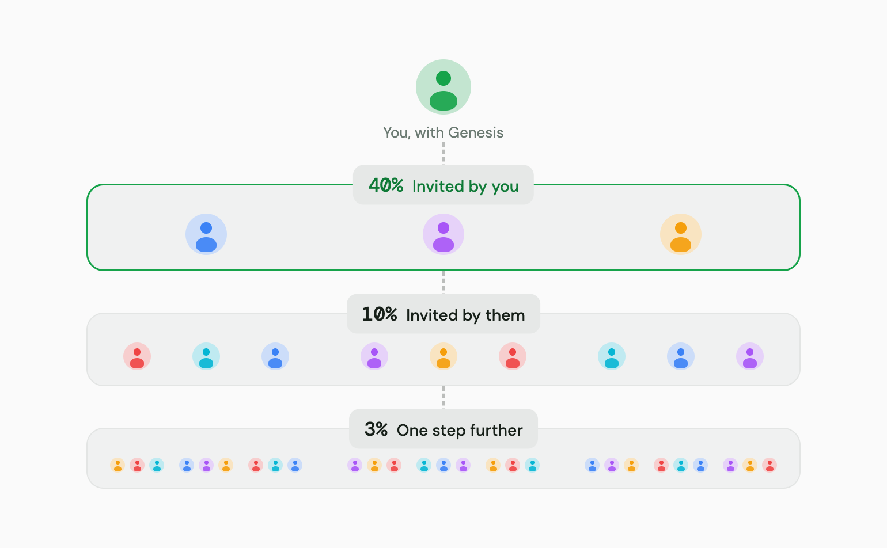
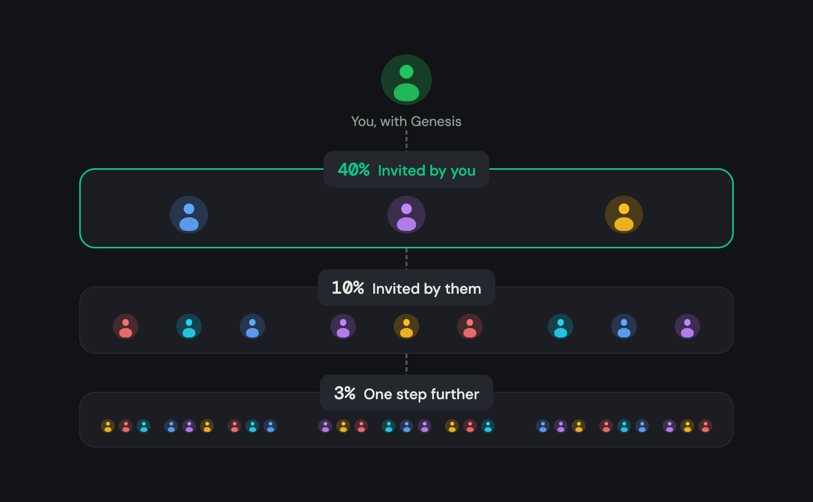
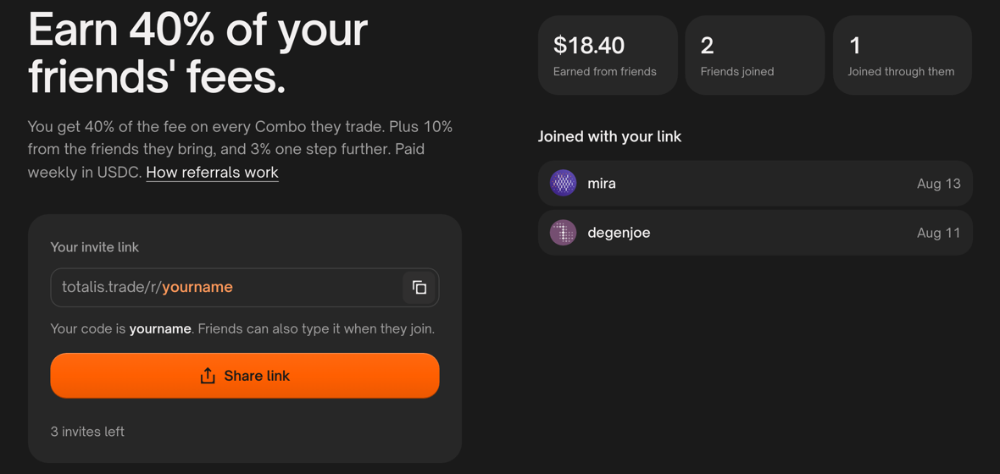

Totalis is invite-only. Your invite link lets a new trader in, and you earn a share of the Combo fees
they pay. A [Genesis account](#genesis-accounts) earns the larger share, plus a share from the
traders those traders invite, and one step further. There is no limit on what you can earn.

| Tier | Who | Genesis account | Other accounts |
| --- | --- | --- | --- |
| Invited by you | Traders who joined with your link | **40%** | **10%** |
| Invited by them | Traders who joined with the links of people you invited | **10%** | 0% |
| One step further | Traders who joined with the links of those traders | **3%** | 0% |

| | |
| --- | --- |
| Which fees | Fees on combos. Single-market trades are not included. |
| Counted from | October 7, 2026 |
| Paid in | USDC, to your Totalis wallet, every week |
| Minimum payout | $5. Less than that carries over to a later week. |

## Genesis accounts

A Genesis account has the Genesis badge next to its name. You earn the badge if, by the end of
December 15, 2026 UTC, your account has X connected and has traded more than $20 of your own money in
Combos. Once earned, it stays. [Referrals](https://app.totalis.trade/referrals#genesis) shows how far
you are.

- The rates in the table apply to fees paid from 00:00 UTC on November 30, 2026. Before that, every
  account earned the Genesis rates.
- If you earn Genesis later, you earn the Genesis rates on fees paid from 00:00 UTC on the day you earn
  it.

## Share your link

<Steps>
  <Step title="Open Referrals">
    In the app, press the gift in the top bar, or open
    [Referrals](https://app.totalis.trade/referrals). Your link looks like `totalis.trade/r/yourname`.
    It unlocks once you have traded $5 on Totalis, HIP-4 markets and Combos combined. Until then,
    the page shows how far you are, and traders who already joined with your link keep earning for
    you.

    <Frame caption="Your invite link, the invites you have left, what you have earned and who has joined">
      
    </Frame>
  </Step>
  <Step title="Share it">
    Press **Share link** and send it anywhere: a group chat, your X bio, a DM. Someone who opens it
    signs in with Google or email and is let in on your invite.
  </Step>
</Steps>

- Every account starts with 5 invites. Each trader who joins with your link uses one. Need more now? Ask on
  [Discord](https://discord.gg/t6wt99tdxz).
- Your link works only for people new to Totalis. Someone already in keeps whoever invited them.
- A trader counts for one referrer only: the one whose link they joined with. You cannot refer
  yourself, because you are already in when you share your link.

## Track your earnings

Once someone has joined with your link, the Referrals page shows what you have earned from every
tier, who joined with your link, and how many more traders joined through them.

- Earnings update once a day, shortly after midnight UTC.
- What you have earned includes what Totalis has already paid you.

## Get paid

Totalis pays referral earnings every week, in USDC, to your Totalis wallet on HyperEVM. You are paid
once what you are owed reaches the minimum. Below it, nothing is lost: the balance carries over and
is paid in a later week.

Each week's earnings are fixed when that week closes. A later change to the rates never changes what
you already earned.
